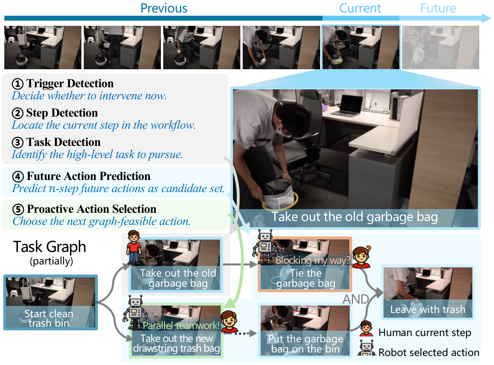

# ProAct: A Benchmark and Multimodal Framework for Structure-Aware Proactive Response

<p align="center">
  <a href="https://arxiv.org/abs/2602.03430"></a>
  <a href="LICENSE"></a>
</p>

<p align="center">
  <video src="https://github.com/user-attachments/assets/5696e51d-b6cf-42b2-abfa-7e885cebab69" poster="pic/tutorial_poster.png" width="720" controls muted playsinline></video>
</p>

<p align="center">
  <i>▶️ ProAct tutorial video (plays inline on GitHub). If it does not render, <a href="https://github.com/ZhuXMMM/ProAct/releases/download/assets/tutorial.mp4">download it here</a>.</i>
</p>

## 🖼️ News

- **[2026-07]** 🎉 ProAct has been accepted to **ICML 2026**!

## Abstract

While passive agents merely follow instructions, proactive agents align with higher-level objectives, such as assistance and safety by continuously monitoring the environment to determine when and how to act. However, developing proactive agents is hindered by the lack of specialized resources. To address this, we introduce **ProAct-75**, a benchmark designed to train and evaluate proactive agents across diverse domains, including assistance, maintenance, and safety monitoring. Spanning 75 tasks, our dataset features 91,581 step-level annotations enriched with explicit task graphs. These graphs encode step dependencies and parallel execution possibilities, providing the structural grounding necessary for complex decision-making. Building on this benchmark, we propose **ProAct-Helper**, a reference baseline powered by a MLLM that grounds decision-making in state detection, and leveraging task graphs to enable entropy-driven heuristic search for action selection, allowing agents to execute parallel threads independently rather than mirroring the human's next step.

<p align="center">
  
</p>

Extensive experiments demonstrate that ProAct-Helper outperforms strong closed-source models, improving trigger detection mF1 by 6.21%, saving 0.25 more steps in online one-step decision, and increasing the rate of parallel actions by 15.58%.

---

## Dataset

Access to the self-collected ProAct data is being prepared for **non-commercial scientific research only**, with **individual manual approval**. See [Dataset Access](data/DATASET_ACCESS.md) for the application process and current setup status, and read the [Data Use Agreement](data/DATA_USE_AGREEMENT.md) before applying.

The Hugging Face application and download endpoint is being configured. During setup, applications may be sent to [zhuxiaomeng224@gmail.com](mailto:zhuxiaomeng224@gmail.com?subject=ProAct%20dataset%20access%20request) using the template in the access instructions. Submission does not automatically grant access. The final release will state its exact scope; access to the self-collected subset does not imply that all media described in the full ProAct-75 benchmark is included.

## Repository Layout

- `train/`: SFT training code and the single runnable training script.
- `test/onestep_planning/`: One-step planning evaluation code and scripts.
- `test/detection_prediction/`: Detection / prediction evaluation helpers and test runner.
- `module_tools/TFace/recognition/README.md`: Third-party face recognition module README (with a note that data will be released in the future).
- `data/`: Research-only dataset access instructions and the data use agreement; video files are hosted separately under controlled access.

## Quickstart

### Environment

Create a Python environment (3.10+ recommended) and install dependencies:

```bash
pip install -r requirements.txt
```

### Data / Paths (required)

Most training scripts are **data-agnostic** and use environment variables for paths:

- `MODEL_NAME_OR_PATH`: base model directory (e.g. a local HuggingFace model folder)
- `TRAIN_JSON`: training JSONL
- `VAL_JSON`: validation JSONL
- `FRAME_ROOT`: frame directory root
- `ANNOTATION_JSON`: annotation file (if needed by your run)
- `PRIORITY_SCORES_JSON`: priority score file (if needed by your run)

Example:

```bash
export MODEL_NAME_OR_PATH=/path/to/Qwen2.5-VL-3B-Instruct
export TRAIN_JSON=/path/to/train.jsonl
export VAL_JSON=/path/to/val.jsonl
export FRAME_ROOT=/path/to/frames
export ANNOTATION_JSON=/path/to/all_annotations.json
export PRIORITY_SCORES_JSON=/path/to/priority_score.json
```

### Train (SFT)

Run a standard training job:

```bash
bash train/run_train.sh
```

### Detection / Prediction test

```bash
bash test/detection_prediction/run_l2_sft_test.sh
```

### Evaluate (One-Step Planning)

The main evaluator is `test/onestep_planning/eval_onestep_end2end.py`.

For cached prediction folders (entropy selector):

```bash
bash test/onestep_planning/run_eval_onestep_ours.sh
```

For LLM-based evaluation via OpenAI-compatible endpoints or Gemini, use the provided scripts under `test/onestep_planning/`.

## Notes

- **No secrets in repo**: API keys are not hardcoded; provide them via environment variables.
- **Offline mode**: Some scripts set `HF_HUB_OFFLINE=1` and `TRANSFORMERS_OFFLINE=1` by default. Override them if you want online downloads.

## Citation

If you find ProAct useful in your research, please consider citing:

```bibtex
@article{proact2026,
  title={ProAct: A Benchmark and Multimodal Framework for Structure-Aware Proactive Response},
  author={ProAct Authors},
  journal={arXiv preprint arXiv:2602.03430},
  year={2026}
}
```

## License

This project's code is released under the [Apache License 2.0](LICENSE).

The self-collected dataset is **not** covered by the code license. It is governed separately by the [Data Use Agreement](data/DATA_USE_AGREEMENT.md), with research-only use and individual access approval.
